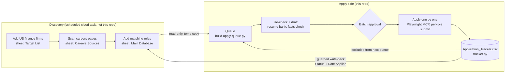

# The full loop

| Stage | Who | What |
|---|---|---|
| Discover firms | Scheduled task | Adds US finance firms to **Target List** |
| Scan careers | Scheduled task | Visits each firm's careers page, logs the result in **Careers Sources** |
| Main Database | Scheduled task | Adds matching roles with Date Added, Fit, Verification, Deadline and a Dedupe Key |
| Queue | `scripts/build-apply-queue.py` | Reads the live workbook (`$JOB_WORKBOOK`) through a temp copy. Keeps New/Interested rows with Fit High/Medium that are open, not closed and not in the tracker. Orders them **Date Added newest first, ties by row**. Joins Careers Sources for the ATS, picks route (`config/job-sources.json`) and resume variant (`config/search-spec.json`, `config/role-title-map.json`). Writes `data/apply-queue.json` |
| Re-check + draft | Claude (`skills/apply-queue`) | Confirms each posting is live and he is eligible (May 2027 graduation), drafts the resume (and cover letter) from the resume bank only; `resume-bank.cjs facts` must pass |
| Approval | Him | Approves the batch and each resume before upload |
| Apply | Claude + him | One role at a time; he handles logins, CAPTCHAs, codes and anything not in `profile.json`; nothing is submitted until he types "submit" |
| Tracker | `scripts/tracker.py` | `Application_Tracker.xlsx`, sheet Applications: one row per role, append-only, deduped on Dedupe Key, updated right after each role. Source of truth for what was applied to |
| Write-back | `scripts/writeback.py` | At the end: sets Status (Applied/Skip) and Date Applied in **Main Database** for those rows only. Skipped if the workbook is open (`~$` lock) or changed during the session; backs up first; edits only that sheet's XML so formatting, validation and formulas survive |

Only three sheets are used: **Target List**, **Careers Sources**, **Main Database**. "Job Database" and
"Jobs" are older sheets and are ignored.
